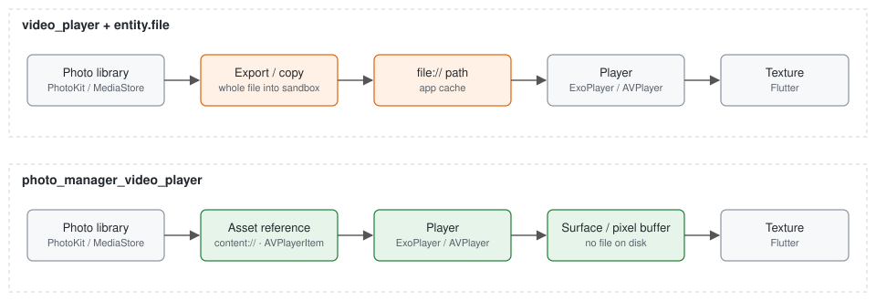

# photo_manager_video_player

[](https://pub.dev/packages/photo_manager_video_player)
[](https://pub.dev/packages/photo_manager_video_player/score)
[](https://github.com/toyaji/photo_manager_video_player/actions/workflows/photo_manager_video_player.yml)
[](https://github.com/toyaji/photo_manager_video_player/blob/main/LICENSE)

Play videos from the device photo library — an
[`AssetEntity`](https://pub.dev/documentation/photo_manager/latest/photo_manager/AssetEntity-class.html)
from [`photo_manager`](https://pub.dev/packages/photo_manager) — **without
copying the original file first**.

With [`video_player`](https://pub.dev/packages/video_player), a gallery video
has to become a file before it can play: `entity.file` copies the whole
original on Android and exports it on iOS. For a 4K clip that takes seconds and
doubles the storage, all before the first frame. This package points the
platform player straight at the library's own reference instead, so playback
starts as soon as the decoder is ready.



```dart
final controller = AssetEntityVideoController(asset);
await controller.initialize();
await controller.play();

AspectRatio(
  aspectRatio: controller.value.aspectRatio,
  child: AssetEntityVideoView(controller),
);
```

## Features

- **No copy, no export.** Android plays the MediaStore `content://` URI with
  ExoPlayer; iOS plays the `AVPlayerItem` PhotoKit hands back.
- **Layout before loading.** Size and duration come from the `AssetEntity`, so
  `AspectRatio` is right from the first build.
- **Gallery-friendly errors.** `initialize()` never throws; failures land in
  `value.error` with a typed code you can switch on.
- **HDR video.** An optional platform view keeps the system's HDR handling.
- **iCloud streaming** on iOS, with download progress.
- **Seamless thumbnail hand-over** on Android: start playback on the exact
  frame the system thumbnail shows.
- **Frame extraction.** JPEG stills at chosen times, read in place.
- **Lifecycle handled.** Pauses in the background, resumes on return, frees
  everything on `dispose()` and on hot restart.

| | Android | iOS |
|---|---|---|
| Minimum version | API 21 | iOS 13 |
| Player | ExoPlayer (media3) | `AVPlayer` |
| Copy of the original | none | none |

macOS, web and desktop are not supported.

## Getting started

### 1. Install

```sh
flutter pub add photo_manager photo_manager_video_player
```

Flutter 3.29 or later is required. Building iOS with Swift Package Manager
needs Flutter 3.44; on older Flutter keep the app on CocoaPods. See
[Requirements](#requirements).

### 2. Set up photo library access

This package reads the library through `photo_manager`, so the app needs the
same platform setup `photo_manager` describes in its
[README](https://pub.dev/packages/photo_manager#prepare-for-use):

- **Android** — `READ_MEDIA_VIDEO` (Android 13+) and `READ_EXTERNAL_STORAGE`
  (Android 12 and below) in `AndroidManifest.xml`.
- **iOS** — `NSPhotoLibraryUsageDescription` in `Info.plist`.

### 3. Ask for permission, then play

The package never asks for permission itself. Request it before creating a
controller:

```dart
final PermissionState ps = await PhotoManager.requestPermissionExtend();
if (!ps.hasAccess) return;

final List<AssetPathEntity> paths =
    await PhotoManager.getAssetPathList(type: RequestType.video);
final List<AssetEntity> videos =
    await paths.first.getAssetListPaged(page: 0, size: 50);

final controller = AssetEntityVideoController(videos.first);
```

A complete gallery with a player page is in the
[example app](https://github.com/toyaji/photo_manager_video_player/tree/main/example).

## Usage

### Show a poster until the first frame

The view is transparent until real pixels arrive. Keep a thumbnail on top —
for example `Image.memory` of `asset.thumbnailData` — and fade it out on
`firstFrameRendered`:

```dart
ValueListenableBuilder<AssetEntityVideoValue>(
  valueListenable: controller,
  builder: (context, value, _) => Stack(
    fit: StackFit.expand,
    children: [
      AssetEntityVideoView(controller),
      AnimatedOpacity(
        opacity: value.firstFrameRendered ? 0 : 1,
        duration: const Duration(milliseconds: 150),
        child: poster,
      ),
    ],
  ),
);
```

### Handle errors

```dart
await controller.initialize();
final AssetEntityVideoError? error = controller.value.error;
if (error != null) {
  final String message = switch (error.code) {
    AssetEntityVideoErrorCode.permissionDenied => 'Allow photo access.',
    // Deleted, or outside a limited (selected photos) grant.
    AssetEntityVideoErrorCode.assetNotFound => 'This video is unavailable.',
    // iOS: only in iCloud and could not be downloaded.
    AssetEntityVideoErrorCode.iCloudUnavailable => 'Could not load from iCloud.',
    AssetEntityVideoErrorCode.playbackFailed => 'This video cannot be played.',
  };
}
```

Passing an `AssetEntity` that is not a video throws an `ArgumentError` — that
is the only exception the controller throws.

### HDR video

A Flutter texture is 8-bit, so HLG, HDR10 and Dolby Vision video lose the
system's HDR rendering. Draw into a platform view instead:

```dart
AssetEntityVideoController(
  asset,
  viewType: AssetEntityVideoViewType.platformView,
);
```

It uses a `SurfaceView` on Android and an `AVPlayerLayer` on iOS. Platform
views cost more to transform and clip, and under zero opacity they are not
drawn at all — cover the view with a poster rather than hiding it.

### Start from the system thumbnail (Android)

A grid that swaps a thumbnail for the playing video jumps unless playback
starts on the frame the thumbnail shows. On Android 8.1+ the package can find
that frame for the MediaStore system thumbnail:

```dart
final Duration? start =
    await AssetEntityVideoFrames.mediaStoreThumbnailPosition(assetId: asset.id);

final controller = AssetEntityVideoController(
  asset,
  startPosition: start ?? Duration.zero,
);
```

It returns `null` when the frame cannot be identified, below Android 8.1, and
on iOS. `startPosition` itself is Android only for now. How the lookup works
and what it costs:
[thumbnail hand-over](https://github.com/toyaji/photo_manager_video_player/blob/main/doc/thumbnail-handover.md).

### Extract frames

```dart
final List<Uint8List?> frames = await AssetEntityVideoFrames.extract(
  assetId: asset.id,
  timesMs: <int>[0, 2000, 4000],
  maxEdge: 480, // longer edge, in pixels
  quality: 70,  // JPEG quality, 0–100
);
```

One entry per time, in order; a frame that fails is `null`. Frames snap to the
nearest sync frame, so they are fast but not frame-exact. Here
`allowNetworkAccess` defaults to `false`: an iCloud-only video throws a
`PlatformException` with code `iCloudUnavailable` instead of downloading.

### iCloud (iOS)

With `allowNetworkAccess: true` (the default) an iCloud-only video streams
while it downloads, and `value.downloadProgress` reports 0–1 until it is
ready. Pass `false` to fail fast with `iCloudUnavailable` instead — useful in
a grid where downloads should be opt-in.

## API at a glance

| Type | Role |
|---|---|
| `AssetEntityVideoController` | A `ValueNotifier` that owns one platform player: `initialize`, `play`, `pause`, `seekTo`, `setVolume`, `setLooping`, `dispose`. |
| `AssetEntityVideoValue` | Current state: `size`, `aspectRatio`, `duration`, `position`, `isInitialized`, `firstFrameRendered`, `isPlaying`, `isBuffering`, `isCompleted`, `isLooping`, `volume`, `downloadProgress`, `error`. |
| `AssetEntityVideoView` | Draws the controller's video, rotated upright. |
| `AssetEntityVideoViewType` | `textureView` (default) or `platformView`. |
| `AssetEntityVideoFrames` | `extract` for JPEG stills, `mediaStoreThumbnailPosition` for the thumbnail hand-over. |
| `AssetEntityVideoError`, `AssetEntityVideoErrorCode` | Typed failure in `value.error`. |

Full reference on
[pub.dev](https://pub.dev/documentation/photo_manager_video_player/latest/).

## What your app owns

The package manages the player, its texture and the app lifecycle. The app
decides:

- **How many players are alive.** Phones allow only a few hardware decoders.
  Keep the visible video and at most a neighbour or two; dispose the rest.
- **Posters, controls and error UI.**
- **Audio policy beyond the default.** On iOS the first player raises the
  default `.soloAmbient` session to `.playback`, so the silent switch does not
  mute video and other apps' audio stops — as with `video_player`. Set
  `.ambient` or `.mixWithOthers` yourself for muted previews that must not
  interrupt music. On Android a muted player (volume 0) does not take audio
  focus.

Details: [lifecycle and ownership](https://github.com/toyaji/photo_manager_video_player/blob/main/doc/lifecycle.md).

## Requirements

| | Minimum |
|---|---|
| Flutter | 3.29 (CocoaPods) / 3.44 (Swift Package Manager) |
| Android | API 21 |
| iOS | 13 |
| `photo_manager` | 3.x |

- Flutter 3.29 is the floor because the Android texture relies on
  `SurfaceProducer.Callback.onSurfaceCleanup`
  ([migration guide](https://docs.flutter.dev/release/breaking-changes/android-surface-plugins)).
- Swift Package Manager builds need the `FlutterFramework` package, which
  `photo_manager` 3.12 builds against only from Flutter 3.44. On older Flutter
  add `disable-swift-package-manager: true` under `flutter:` in the app's
  `pubspec.yaml`.
- CI builds a new app against both minimums and current stable on every push.

## Not supported

Network URLs (use `video_player`), picture-in-picture, DRM, casting, captions,
playback speed, buffered ranges, background playback and macOS. A display
matrix that mirrors the picture is drawn without the mirroring.

## Learn more

- [How it works](https://github.com/toyaji/photo_manager_video_player/blob/main/doc/how-it-works.md) — playback path, frame delivery, HDR, comparison with `video_player`
- [Lifecycle and ownership](https://github.com/toyaji/photo_manager_video_player/blob/main/doc/lifecycle.md) — controller states, audio, app lifecycle, hot restart
- [Thumbnail hand-over](https://github.com/toyaji/photo_manager_video_player/blob/main/doc/thumbnail-handover.md) — `startPosition` and `mediaStoreThumbnailPosition`
- [Changelog](https://github.com/toyaji/photo_manager_video_player/blob/main/CHANGELOG.md)

## Contributing

Bug reports and pull requests are welcome on
[GitHub](https://github.com/toyaji/photo_manager_video_player/issues).
The package's own tests need Flutter 3.32 or later (`flutter_lints` 6 needs
Dart 3.8):

```sh
flutter test
cd example && flutter test integration_test
```

## License

[Apache-2.0](https://github.com/toyaji/photo_manager_video_player/blob/main/LICENSE).
