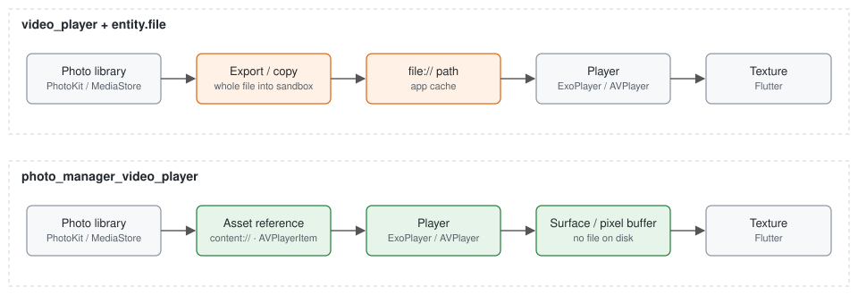
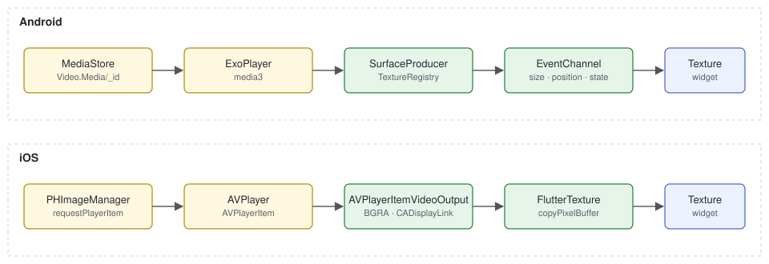

# How it works

What happens between an `AssetEntity` and pixels on screen, and how that differs from `video_player`.

## Compared with `video_player`



`video_player` plays files and URLs. To play a gallery asset with it, an app
first calls `entity.file`, which on Android copies the whole original into the
app cache and on iOS runs an `AVAssetExportSession`. For a 4K clip that copy
takes seconds and doubles the storage the video occupies, and it happens
before the first frame can appear. In a swipeable gallery, the copy *is* the
latency.

This package skips the file. The platform player is pointed straight at the
library's own reference to the asset, and frames are drawn into a Flutter
texture the same way `video_player` draws them.

| | `video_player` + `entity.file` | `photo_manager_video_player` |
|---|---|---|
| Input | file path or URL | `AssetEntity` |
| Disk writes before first frame | full copy / export | none |
| Time to first frame | copy time + decoder spin-up | decoder spin-up |
| iCloud-only asset (iOS) | export fails or blocks | streams while downloading, with `downloadProgress` |
| Layout before metadata | unknown until initialized | seeded from `AssetEntity` size and duration |
| Errors | thrown from `initialize()` | typed `value.error`, never thrown |
| Network URLs, captions, DRM, PiP | yes | not in scope |

Both can live in one app: keep `video_player` for remote streams and use this
package for anything that comes from the photo library.

## How frames reach the screen



**Android.** The asset id is a MediaStore `_ID`; it becomes
`content://media/external/video/media/<id>` and is given to ExoPlayer as a
`MediaItem`. ExoPlayer renders into the `Surface` of a
`TextureRegistry.SurfaceProducer`, which is the Flutter texture. Playback
state, video size, position, and first-frame events are forwarded on an
`EventChannel` from ExoPlayer's listener.

**iOS.** The asset id is a `PHAsset.localIdentifier`. `requestPlayerItem` returns
an `AVPlayerItem` that plays the library file in place (or streams it from
iCloud when `allowNetworkAccess` is true). An `AVPlayerItemVideoOutput`
configured for 32-bit BGRA is attached to the item; a `CADisplayLink` polls it
once per display refresh and, when a new frame exists, marks the Flutter
texture dirty. Flutter then calls `copyPixelBuffer`, which hands over the
latest `CVPixelBuffer` without copying its bytes.

On both platforms the video surface belongs to the player until `dispose()`.
When the texture path does not apply the orientation metadata itself, the
quarter turn is reported as `rotationCorrection` and `AssetEntityVideoView`
rotates the texture, so nothing is re-encoded. To draw the video yourself,
use `controller.textureId` in a `Texture` widget with the same rotation.

## HDR: platform view

A texture is composited into the Flutter layer,
which is 8-bit, so HLG/HDR10/Dolby Vision video loses the system's HDR
handling: on Android it looks brighter and flatter than in the Gallery app,
and on iOS it is tone-mapped to SDR. Pass
`viewType: AssetEntityVideoViewType.platformView` to draw into a platform view
instead (as `video_player`'s `VideoViewType.platformView`) — a `SurfaceView` on
Android, an `AVPlayerLayer` on iOS. The video keeps the system's HDR handling,
and on iOS an SDR screen still gets the system's tone mapping. The platform
rotates those frames, so `rotationCorrection` is 0 and `textureId` is null. It
composites like any platform view, and under a zero opacity it is not drawn at
all, so cover it rather than hide it until `firstFrameRendered`.

## Frame extraction

`AssetEntityVideoFrames.extract` returns JPEG stills for a list of times — for
thumbnail strips, or to hand a few frames to an image model — through the
same zero-copy resolution as playback.

```dart
final List<Uint8List?> frames = await AssetEntityVideoFrames.extract(
  assetId: asset.id,
  timesMs: <int>[0, 2000, 4000],
  maxEdge: 480,   // longer edge, in pixels
  quality: 70,    // JPEG quality, 0–100
);
```

| | Android | iOS |
|---|---|---|
| Resolve | `MediaStore.Video.Media` `content://` URI | `PHImageManager.requestAVAsset` |
| Decode | `MediaMetadataRetriever.getScaledFrameAtTime` (`getFrameAtTime` + scale below API 27) | `AVAssetImageGenerator`, preferred track transform applied |
| Bytes copied | **0** | **0** |

- The asset is opened once per call, whatever the number of times.
- The result has one entry per time, in order; a frame that fails is `null`.
- Frames snap to the nearest sync frame: fast, but not frame-exact.
- `allowNetworkAccess` defaults to **false** here. An iCloud-only video then
  throws a `PlatformException` with code `iCloudUnavailable` instead of
  downloading. Android ignores the flag.
- Only a failure to open the asset throws; its code is one of the names in
  [Errors](https://github.com/toyaji/photo_manager_video_player/blob/main/README.md#handle-errors).

[← Back to README](https://github.com/toyaji/photo_manager_video_player/blob/main/README.md)
