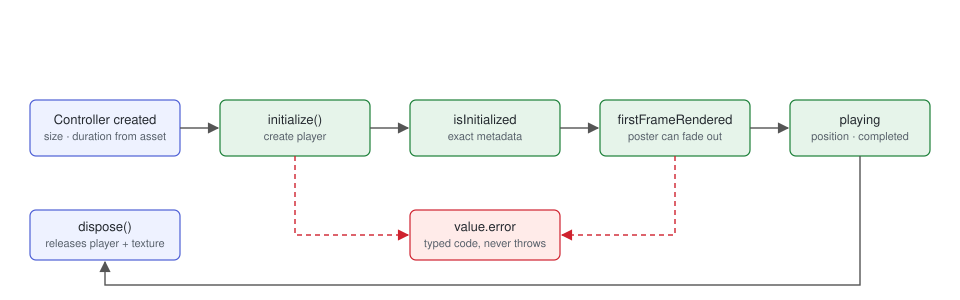

# Lifecycle and ownership

What the controller does at each step, and which concerns belong to the package or to the app.

## Controller lifecycle

`AssetEntityVideoController` is a `ValueNotifier<AssetEntityVideoValue>`.

1. **Created.** `value.size` and `value.duration` are seeded from the
   `AssetEntity`, so `AspectRatio` lays out correctly before any native work
   has started. Nothing is allocated yet.
2. **`initialize()`.** Creates the platform player and a texture. Returns when
   the player has reported its metadata; `size` and `duration` are now exact.
   Calling it twice returns the same future. `play()` initializes on demand.
   Before initialization `setVolume()` and `setLooping()` only store the
   value, which is applied when the player is created; `pause()` cancels a
   pending `play()`, and `seekTo()` does nothing.
3. **`firstFrameRendered`.** The texture has real pixels. This is the moment
   to fade out a poster thumbnail; before it the texture is transparent.
4. **Playing.** `position` updates while playing; `isCompleted` is set when
   playback reaches the end and cleared by the next `play()`. `seekTo()` is
   clamped to `0`–`duration`.
5. **`dispose()`.** Releases the player, the texture, and the event
   subscription, and completes once the platform player is gone. When
   `initialize()` is still in flight, the future waits for the player to be
   created and then released.

Any failure lands in `value.error` with a typed `AssetEntityVideoErrorCode`
and stops playback. `initialize()` never throws, so a gallery can warm up a
neighbouring page without awaiting it; check `value.hasError` after awaiting.
The one exception is a programming error: passing a non-video `AssetEntity`
to the constructor throws an `ArgumentError`.

## `AssetEntityVideoValue`

| Field | Meaning |
|---|---|
| `size`, `aspectRatio` | Upright frame geometry. Seeded from the asset, corrected from the player |
| `rotationCorrection` | Clockwise quarter turn the raw texture needs; only for drawing `textureId` yourself |
| `duration`, `position` | Same |
| `isInitialized` | Player reported metadata |
| `firstFrameRendered` | Texture holds a real frame |
| `isPlaying`, `isBuffering`, `isCompleted`, `isLooping`, `volume` | Playback state |
| `downloadProgress` | iOS only, 0–1 while an iCloud asset streams in; `null` otherwise |
| `error` | `AssetEntityVideoError(code, message)` or `null` |

## Who owns what

| Concern | Owner | Notes |
|---|---|---|
| How many players are alive | App | Devices allow only a handful of hardware decoders. Keep the visible one plus at most a neighbour or two; dispose the rest. |
| Poster and cross-fade | App | Show a thumbnail until `firstFrameRendered`. |
| Controls, scrubbing UI, mute policy | App | The controller exposes `play`, `pause`, `seekTo`, `setVolume`, `setLooping`; drawing controls is the app's job. |
| Error UI | App | Switch on `value.error?.code`. |
| Audio session and focus | Package, minimal | Android: an audible player takes audio focus, so other audio pauses; a muted player (volume 0) does not. iOS raises the default `.soloAmbient` session to `.playback` once, on the first player, so the silent switch does not mute video; any category the app set is kept. With that default, starting any player on iOS, muted or not, stops other apps' audio, as with `video_player`; an app whose muted previews must not do that sets `.ambient` or `.mixWithOthers` itself. Mixing with other audio, ducking and Now Playing are the app's. |
| App lifecycle | Package | Playback pauses when the app goes to the background and resumes on return if it was playing. A `play()` called in the background, or still waiting for initialization when the app leaves, starts on return. Background playback is not offered. |
| Audio interruptions (calls, other apps) | App | The system pauses playback and `isPlaying` turns false; resuming afterwards is the app's decision. |
| Asset resolution | Package | MediaStore URI on Android, `PHAsset` lookup on iOS. |
| Player and texture lifetime | Package | One player per controller; both freed in `dispose()` and on engine detach. |
| Hot restart | Package | The engine survives a hot restart but the Dart side does not, so the first `create` after a restart asks the platform to drop every player from the previous isolate. |
| Event delivery | Package | One `EventChannel` per player; malformed events are ignored rather than thrown. |

## Errors

| Code | Meaning |
|---|---|
| `assetNotFound` | The id no longer resolves to an asset, or the asset is outside a limited (selected-photos) grant |
| `permissionDenied` | The app has no photo library access at all |
| `iCloudUnavailable` | iOS: the asset is in iCloud and `allowNetworkAccess` is false, or the download failed |
| `playbackFailed` | The platform player reported an error |

## iCloud (iOS)

With `allowNetworkAccess: true` (the default) PhotoKit streams an iCloud-only
video while it downloads; `downloadProgress` reports 0–1 until
`isInitialized`. Set it to false to fail fast with `iCloudUnavailable`
instead, for example in a grid where downloads should be opt-in.

## Tested configurations

| | Minimum | Checked on |
|---|---|---|
| Flutter | 3.29 | CI builds a new app with 3.29.3 (APK, iOS through CocoaPods) and with current stable; devices run 3.44 |
| iOS through Swift Package Manager | Flutter 3.44 | CI builds a new app with 3.44.0 |
| Android | API 21 (media3-exoplayer 1.4.1) | API 28 and 36 emulators, Galaxy S21 (Android 15) |
| iOS | 13 | iOS 26.2 simulator, iPhone 14 (iOS 26) |

- Call `PhotoManager.requestPermissionExtend()` before creating a controller;
  the package does not request permission.
- Flutter 3.29 is the floor because the Android texture relies on
  `SurfaceProducer.Callback.onSurfaceCleanup`, added in 3.29
  ([Flutter's migration guide](https://docs.flutter.dev/release/breaking-changes/android-surface-plugins)).
- Swift Package Manager builds need Flutter 3.44: they depend on the
  `FlutterFramework` package, which Flutter generates from 3.41, and
  `photo_manager` 3.12.0 only builds against it from 3.44. On older Flutter,
  keep the app on CocoaPods with `disable-swift-package-manager: true` under
  `flutter:` in the app's `pubspec.yaml`.

[← Back to README](https://github.com/toyaji/photo_manager_video_player/blob/main/README.md)
